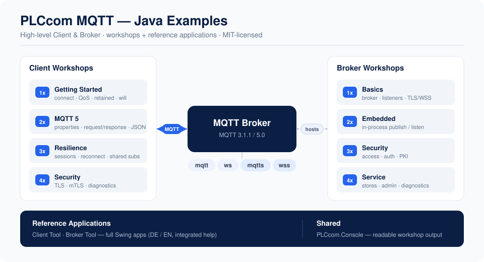

# PLCcom MQTT — Java Workshops & Reference Applications

**Hands-on MQTT for Java developers — a comfortable high-level Client and an embeddable Broker.**

MQTT looks simple — connect, publish, subscribe — but real projects get concrete fast: which QoS should this message use, does a late subscriber see the last value, what happens when a device drops off the network, how do I attach a content type or a correlation id, and how do I secure the transport with TLS or a client certificate?

This repository is a **practical learning path** that answers those questions with small, readable, runnable programs. Each workshop is a self-contained scenario: it prints a framed explanation, runs a real MQTT flow against a broker, checks the result and tells you exactly what to expect. When you outgrow the console examples, two full **reference applications** (a Client tool and a Broker tool) let you click through the same features by hand.

Everything here uses the **high-level PLCcom MQTT API** only — the comfortable Client and Broker surface, not the wire protocol.

## 🧭 What You Will Find Here

| Area | What it teaches | Typical use |
|------|-----------------|-------------|
| **Client Workshops** | Connect, QoS, retained messages, Last Will, all MQTT 5 properties and subscription options, request/response, JSON, sessions, reconnect, async, shared subscriptions, TLS/mTLS/WSS and diagnostics. | Learn the client side step by step, from a first connection to a secured, resilient application. |
| **Broker Workshops** | Standalone and embedded brokers, multiple listeners, TLS/WSS with per-port certificates, in-process publish/listen, retained state, access control, authentication & PKI, custom stores, admin & diagnostics. | Host your own MQTT broker inside a Java product, edge gateway or test environment. |
| **Reference Applications** | Two complete Swing applications — a Client tool and a Broker tool — with DE/EN UI and integrated help. | Manual testing, demos and troubleshooting against real devices, Mosquitto or each other. |
| **PLCcom.Console** | The shared Swing console window used by the workshops. | Keeps workshop output readable without duplicating console code. |

## 🗂️ Repository Layout

~~~text
pom.xml                             reactor: builds the modules below in the right order
PLCcom.Console/                     shared Swing console window
Workshops/
  Client/                           13 client workshops (grouped 1x..4x)
    gettingstarted/  mqtt5/  resilience/  security/
  Broker/                           10 broker workshops (grouped 1x..4x)
    basics/  embedded/  security/  service/
Reference_Applications/
  Client/                           full Swing client tool
  Broker/                           full Swing broker tool
assets/                             overview graphic
README.md                           this file
~~~

The root `pom.xml` is a thin reactor: its only job is to build the modules in order — the shared `PLCcom.Console` first, then the workshops and reference applications. It sets no versions and no dependencies, so you can just as well build, import or run any single module on its own.

Each workshop class is numbered `_1x`, `_2x`, `_3x`, `_4x`. The tens digit is the topic group (shown by the package name), the ones digit is the order inside the group — so the folder tree already reads like the learning path.

## 🚦 Recommended Learning Path

**Client** — start here if you connect *to* a broker:

| Step | Workshop | Why |
|------|----------|-----|
| 1 | `gettingstarted/_11_FirstConnection` | The smallest complete rhythm: connect, subscribe, publish, receive, close. |
| 2 | `gettingstarted/_12_PublishSubscribeAndQos` | Choose QoS 0/1/2 deliberately and use topic wildcards. |
| 3 | `gettingstarted/_13_RetainedMessagesAndLastWill` | Remember state and announce unexpected disconnects. |
| 4 | `mqtt5/_21..._24` | MQTT 5 properties, subscription options, request/response and JSON. |
| 5 | `resilience/_31..._33` | Sessions, reconnect, async API and shared subscriptions. |
| 6 | `security/_41_SecureConnection`, `_42_DiagnosticsAndErrorHandling` & `_43_EnhancedAuthentication` | TLS/mTLS/WSS, structured diagnostics and MQTT 5 enhanced authentication. |

**Broker** — start here if you host a broker:

| Step | Workshop | Why |
|------|----------|-----|
| 1 | `basics/_11_FirstBroker` | Start the smallest standalone broker and read its bound port. |
| 2 | `basics/_12..._14` | Multiple listeners, secure listeners, and all four transports with per-port certificates. |
| 3 | `embedded/_21..._22` | Own the broker lifecycle in Java; publish and listen in-process. |
| 4 | `security/_31..._32` | Access control, authentication and PKI. |
| 5 | `service/_41..._42` | Durable custom stores, admin snapshots and diagnostics. |

## 🔗 Client ↔ Broker Pairing

The two sides are independent, so you can mix and match — a PLCcom client against a PLCcom broker, a PLCcom client against Mosquitto, or a client tool against the broker tool. A convenient pairing to see the whole picture:

1. Start **Broker Workshop `basics/_11_FirstBroker`** (or a local Mosquitto on `mqtt://localhost:1883`).
2. Run **Client Workshop `gettingstarted/_11_FirstConnection`** and point it at that broker.
3. For TLS, pair **Broker `basics/_13_SecureListeners`** with **Client `security/_41_SecureConnection`**.

Every client workshop reads its broker address from a visible `BROKER_ENDPOINT` constant and can be overridden without editing the file:

~~~powershell
-Dplccom.mqtt.workshop.endpoint=mqtt://localhost:1883
~~~

## 📦 Maven Package

The examples use the PLCcom MQTT Java packages:

~~~xml
<!-- Client-side applications -->
<dependency>
    <groupId>com.indi-an.plccom</groupId>
    <artifactId>plccom-mqtt-client</artifactId>
    <version>2.1.2</version>
</dependency>

<!-- Broker-side applications -->
<dependency>
    <groupId>com.indi-an.plccom</groupId>
    <artifactId>plccom-mqtt-broker</artifactId>
    <version>2.1.2</version>
</dependency>
~~~

Both artifacts are on Maven Central and pull in `plccom-mqtt-core` (and gson) transitively, so you only declare the side you use.

**Each module is self-contained.** Open any module's own `pom.xml` and the SDK version is written right there, at the dependency — there is no hidden parent that controls it. To target another PLCcom MQTT release, change the `<version>` in the module you build (the workshop or reference-application module you are using).

The root `pom.xml` is only a reactor — it lists the modules and builds them in the right order (the shared `PLCcom.Console` first). It never overrides the SDK version, which stays visible in each module's own `pom.xml`. In your IDE you import the **module** folders, not the root: with an Eclipse workspace at the repository root, m2e skips the root aggregator (the harmless "existing workspace folder" note) and imports each module as its own project — exactly as in the sibling PLCcom OPC UA example repository.

## 🧰 Requirements

- Java 11 or newer
- Maven 3.8 or newer
- A valid PLCcom MQTT license user name and serial number
- A running MQTT broker for the client workshops (a broker workshop, the broker tool, or Mosquitto)
- A desktop environment for the Swing console and the reference applications

## 🚀 Getting Started

### 1. Clone

~~~bash
git clone https://github.com/Indi-An/PLCcom-mqtt-example-java.git
cd PLCcom-mqtt-example-java
~~~

### 2. Add your license credentials

You need a PLCcom MQTT license (a user name and a serial number). Two ways to get one:

- **Free trial** — generate a time-limited trial license on the [PLCcom MQTT download page](https://www.indi-an.com/en/plccom/mqtt/mqtt-download/).
- **Purchase** — buy a full license on the [PLCcom MQTT buy page](https://www.indi-an.com/en/plccom/mqtt/mqtt-buy/).

Every workshop shows exactly where to put your credentials — a visible block near the top of each class:

~~~java
private static final String LICENSE_USER   = "<Enter your UserName here>";
private static final String LICENSE_SERIAL = "<Enter your Serial here>";
~~~

Replace both values with the credentials from your license (trial or purchased). A client-only license is enough for the client workshops; broker workshops need a broker (or broker+client) license.

### 3. Build

One command in the repository root builds everything — the reactor builds the shared `PLCcom.Console` first, then the workshops and reference applications:

~~~powershell
mvn clean install
~~~

Prefer a single module? Point Maven at that module's own `pom.xml`, e.g. `mvn -f Workshops/Client/pom.xml compile` (the shared console must be installed once first: `mvn -f PLCcom.Console/pom.xml install`).

### 4. Run a workshop

Open the workshop class in your IDE and run its `main()` method, or use Maven. Build once first (step 3), then start a broker and a client:

~~~powershell
# Terminal 1 - broker
mvn -f Workshops/Broker/pom.xml exec:java -Dexec.mainClass=com.plccom.mqtt.examples.broker.basics._11_FirstBroker

# Terminal 2 - client (point it at the broker or a local Mosquitto)
mvn -f Workshops/Client/pom.xml exec:java -Dexec.mainClass=com.plccom.mqtt.examples.client.gettingstarted._11_FirstConnection
~~~

Run a reference application the same way:

~~~powershell
mvn -f Reference_Applications/Client/pom.xml exec:java
mvn -f Reference_Applications/Broker/pom.xml exec:java
~~~

## 🧪 Client Workshop Map

| # | Workshop | Short description |
|---|----------|-------------------|
| 11 | First Connection | Connect, protocol selection, Topic Name vs Topic Filter, one QoS 1 round trip. |
| 12 | Publish, Subscribe & QoS | QoS 0/1/2 explained and topic wildcards on one subscription. |
| 13 | Retained Messages & Last Will | Set, read and delete retained state; fire and suppress a Last Will. |
| 21 | MQTT 5 Message Properties | Content Type, Payload Format, User Properties, Message Expiry, Topic Alias. |
| 22 | MQTT 5 Subscription Options | Subscription Identifier, No Local, Retain As Published, Retain Handling. |
| 23 | Request / Response | Response Topic and Correlation Data with a visible responder client. |
| 24 | JSON Mapping | Publish a Java object as JSON and read it back as the same type. |
| 31 | Sessions, Reconnect & Lifecycle | Persistent session, offline queue, automatic reconnect, lifecycle callbacks. |
| 32 | Async API | The same MQTT flow using non-blocking `CompletableFuture` calls. |
| 33 | Shared Subscriptions | Load-balance a job stream across two workers. |
| 41 | Secure Connection | TLS, WSS and mutual TLS with a client-side trust/key store. |
| 42 | Diagnostics & Error Handling | Diagnostic listener, level filtering, Quality checks and error handling. |
| 43 | Enhanced Authentication | Client-side MQTT 5 enhanced authentication: method + token and AUTH challenges (pairs with Broker 32). |

## 🛰️ Broker Workshop Map

| # | Workshop | Short description |
|---|----------|-------------------|
| 11 | First Broker | The smallest standalone broker; start it, read the port, stop it cleanly. |
| 12 | Listeners & Bind Addresses | Several TCP ports plus a WebSocket listener on one broker. |
| 13 | Secure Listeners | Plain TCP + TLS (mqtts) + secure WebSocket (wss) with an auto-created certificate. |
| 14 | All Listener Types | All four transports on one broker, with a **per-port certificate**. |
| 21 | Embedded Broker in a Java App | Own the lifecycle; publish and listen in-process, with options, batch and JSON. |
| 22 | Retained Messages & Sessions | Retained replay and deletion; session/queue behavior explained. |
| 31 | Access Control | An access validator for CONNECT/PUBLISH/SUBSCRIBE with deny-by-default. |
| 32 | Authentication & PKI | Username/password, MQTT 5 enhanced authentication and where PKI/mTLS fit. |
| 41 | Custom Stores | Move retained/session state into your own durable storage. |
| 42 | Admin & Diagnostics | Read-only admin snapshots, safe counter reset and structured diagnostics. |

## 🔐 TLS, mTLS and the PKI Store

The security workshops use TLS to protect the transport. The broker owns a server certificate; the client uses a trust store to verify it, and optionally a key store to authenticate itself (mutual TLS). Broker certificates can be created on demand in a local PKI folder or assigned **per port**, so one broker can present different identities on different ports.

The generated PKI/TLS folders are ignored by Git on purpose: they are local runtime material, not source code. Some workshops relax hostname or certificate checks to keep the flow readable — that is convenient for learning, not a production security policy. For the full picture see the official [Security Guide](https://docs.plccom.net/help_mqtt/java/docs/en/appendix-a-security-guide-plccom-mqtt-java-en.pdf).

## 🖥️ Reference Applications

The two Swing tools are complete, clickable versions of the same features:

- **Client Tool** — connect to any broker, publish/subscribe, try QoS 2, retained messages, MQTT 5 request/response, subscription identifiers, TLS and diagnostics.
- **Broker Tool** — start a configurable broker with TCP/WS/TLS/WSS listeners, publish and listen in-process, review statistics and diagnostics, and try access validation.

Both ship with a German/English interface and integrated help.

## 📚 Documentation

The complete PLCcom MQTT documentation lives at **[docs.plccom.net](https://docs.plccom.net/)**.

**Guides (PDF, English)**

- [First Steps](https://docs.plccom.net/help_mqtt/java/docs/en/first-steps-plccom-mqtt-java-en.pdf) — install, license and your first MQTT program
- [Appendix A — Security Guide](https://docs.plccom.net/help_mqtt/java/docs/en/appendix-a-security-guide-plccom-mqtt-java-en.pdf) — TLS, mTLS, WSS and PKI
- [Appendix B — Client Guide](https://docs.plccom.net/help_mqtt/java/docs/en/appendix-b-client-guide-plccom-mqtt-java-en.pdf) — the full client API
- [Appendix C — Broker Guide](https://docs.plccom.net/help_mqtt/java/docs/en/appendix-c-broker-guide-plccom-mqtt-java-en.pdf) — the full broker API

**API reference (Javadoc)**

- [plccom-mqtt-client](https://docs.plccom.net/help_mqtt/java/javadoc/com.indi-an.plccom.plccom-mqtt-client/javadoc/index.html)
- [plccom-mqtt-broker](https://docs.plccom.net/help_mqtt/java/javadoc/com.indi-an.plccom.plccom-mqtt-broker/javadoc/index.html)
- [plccom-mqtt-core](https://docs.plccom.net/help_mqtt/java/javadoc/com.indi-an.plccom.plccom-mqtt-core/javadoc/index.html)

## 📄 Licensing Information

**Examples License** — all example sources in this repository are released under the [MIT License](LICENSE). You may use, modify and distribute them according to the license terms.

**PLCcom Library License** — the PLCcom MQTT library itself is proprietary software and is **not** part of the MIT license. To use the SDK in your own applications you need a valid PLCcom MQTT license and must accept the applicable EULA. More information: [www.indi-an.com](https://www.indi-an.com).

## ⚠️ Safety Notice

These examples are written for learning, integration tests and manual validation. Do **not** use them unchanged in production, safety-critical or industrial environments. Review topics, QoS, retained state, timeouts, TLS settings, certificate trust and authorization logic before connecting to real equipment. Use at your own risk.

## ™️ Trademark Information

All product names, company names and trademarks referenced in this repository are trademarks or registered trademarks of their respective owners. Their use is solely for identification and interoperability documentation.
